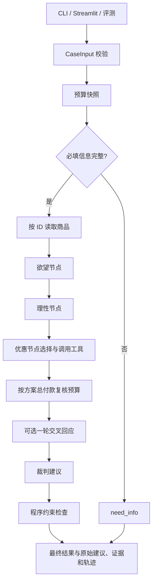
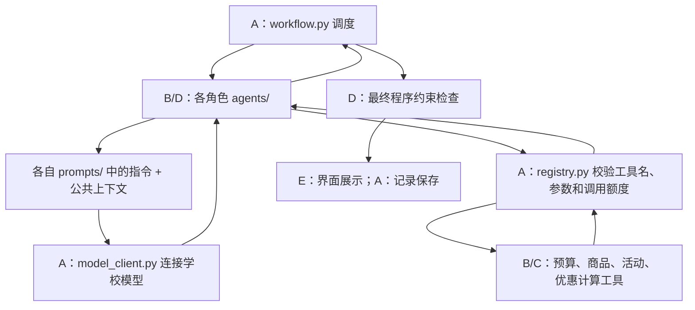

# 系统流程图与运行说明（A—E 全员共读）

先读 [总体结构](README.md)，再对照本页理解执行顺序；具体文件可查 [文件地图](file_map.md)。

## 一次运行的完整流程

`run_case(case, config, services=None) -> RunRecord` 是唯一业务入口。
CLI、界面和后续基线不能各自再写一套流程。

`Services` 注入模型、工具与角色函数。替换一个模块不应修改其他模块。
`build_services()` 仅根据明确的 `mode` 选择正式或演示函数，每次运行新建计数器。
先串行调试；若之后改为并发，A 须处理上下文隔离、轨迹合并和超时。

## 演示与正式模式

`demo` 使用 `demo.py`、`FakeModel` 和手工 fixture；流程、校验、保存与 UI 为真实基础设施。
`real` 使用 B/C/D 的正式接口和学校 ChatModelClient；当前正式接口抛出 ModuleNotReady。
连接适配层已写好，但不等于角色策略、工具循环已完成。

演示 `verified=true` 只表示手工 fixture 已算术复核，`verification_method=demo_fixture`。
它不证明全局最优，也不验证实时活动。正式求解器应设置 `solver`，并完成规则检查。
评测运行器会拒绝演示记录。

## 状态与失败

| 状态 | 含义 |
|---|---|
| running | 正在执行 |
| completed | 成功产生通过基础校验的最终建议，仍需查看 mode |
| needs_input | 缺信息或方案/引用无法确认，最终 action=need_info |
| partial | 未实现、工具上限、超时等中止，保留已有证据 |
| failed | 输入之后的基础设施失败，或没有形成可用中间状态 |

输入格式错误由 UI/CLI 显示，不制造完整运行记录。运行中失败保存轨迹与错误类别。
工具调用总次数上限为 6（包含总控预算初算/复算与商品查询，比原方案只限制优惠节点更严格）。
正常演示使用 5 次，优惠节点仍可用的额度需自行读取，不能假定有 6 次独立额度。
结构化输出失败最多重试一次；连接失败不自动重复计费。
时间上限在节点与工具边界检查，HTTP 使用剩余时间限制。
同步函数正在执行时不能强制中断；C 必须保证有限穷举，新增联网工具必须自带超时。

当前可选交叉回应接口已预留，默认关闭。D 完成后，A 将配置中的
`cross_response_enabled=true`；总控只调用一次，不能在节点内部递归辩论。

## 可追溯性

RunRecord 保存输入、无密钥配置、协议/包版本、提示词 SHA-256、模型名、
工具请求与结果、模型用量与耗时、论点、证据、原始建议、调整原因和最终建议。
正式实验由 E 额外记录 Git commit SHA、数据文件哈希和随机化设置。
模型不返回内部思考过程；只保存适合展示的观点和必要输出。

关键证据 ID：`input:profile`、`input:request`、`budget:initial`、`budget:final`、
`product:<id>`、`promotion:<id>`、`offer:chosen`。D 返回的新证据不可覆盖旧 ID。

## 角色、模型与工具如何连接

该图说明职责连接；正式角色策略仍需 B/D 实现。并非每个角色都需要调用工具，
优惠角色负责基于中间结果选择工具；总控也直接调用预算和商品工具。
角色提交观点或建议，工具返回结构化计算与数据，最后由总控收集。
